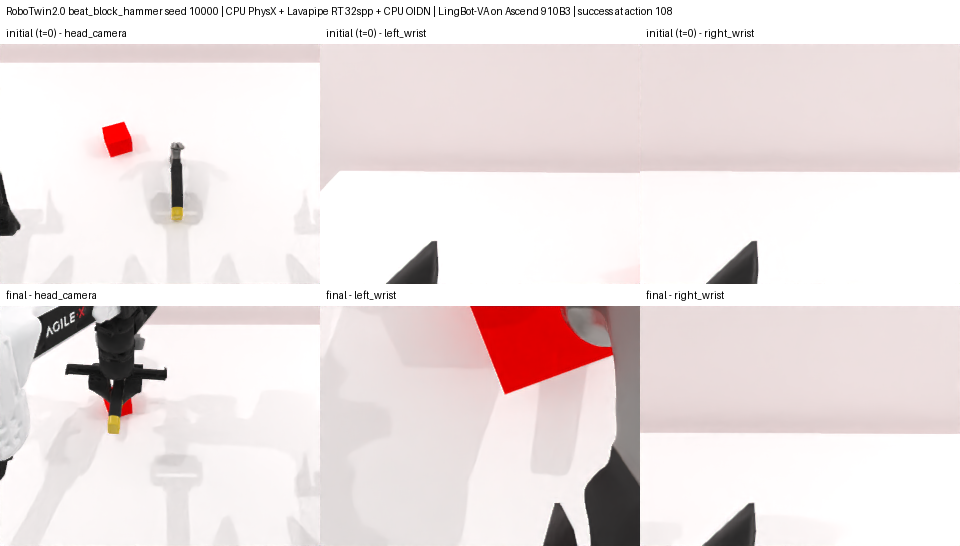
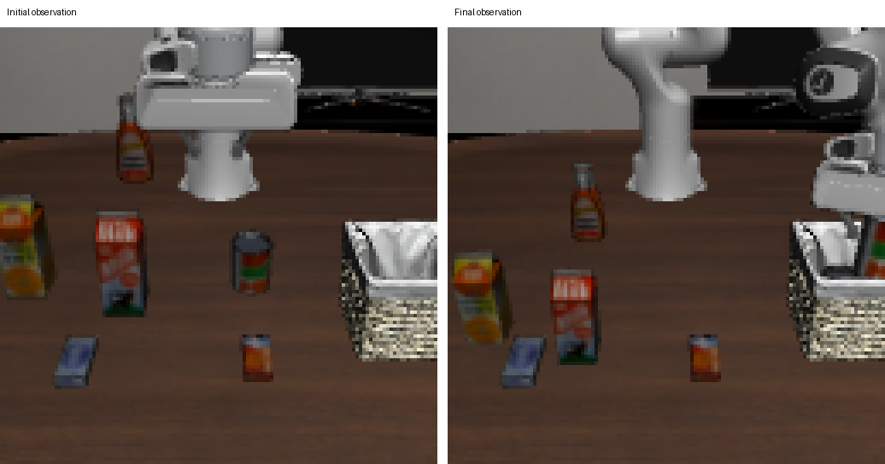
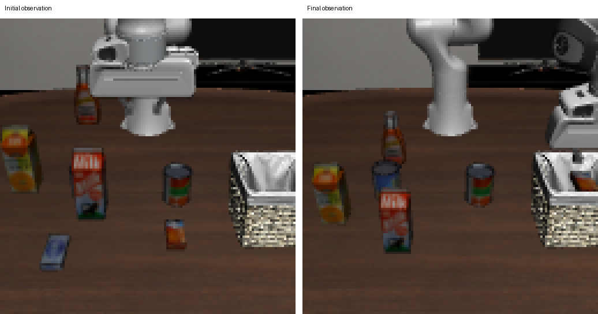

# arm64-cpu-robot-sim

面向 code agent 的 ARM64 机器人 CPU 仿真经验库：环境配置、验证脚本、移植补丁和踩坑记录。

目前在 **鲲鹏 920 / openEuler 24.03** 上验证。仿真与渲染使用 CPU，闭环示例中的 LingBot-VA 使用昇腾 NPU 推理。以下是两套独立的仿真环境。

## RoboTwin / RMBench

**SAPIEN / PhysX + Mesa Lavapipe CPU 光追，可选 CPU OIDN 降噪。**

RoboTwin 2.0 闭环结果（32 spp、阴影、OIDN）：

| 任务 | 结果 | 动作数 | 耗时 |
|---|---|---:|---:|
| click_bell | 成功 | 61 | 595 秒 |
| beat_block_hammer | 成功 | 108 | 785 秒 |



RMBench 另验证了 Press Button 光追和 10 个任务的光栅化 expert 检查，见[硬件与验证记录](docs/hardware.md)。

[环境搭建](docs/setup.md) · [底层检查与渲染脚本](docs/probe.md) · [RoboTwin / RMBench 接入与补丁](docs/robotwin-rmbench.md)

## LIBERO

**MuJoCo / robosuite + Mesa llvmpipe CPU 软件光栅化（OSMesa / EGL）。**

LIBERO-Long 闭环结果（OSMesa，双相机 128×128）：

| 任务 | 结果 | 动作数 | 耗时 |
|---|---|---:|---:|
| task 0：汤罐和番茄酱入篮 | 成功 | 283 | 409 秒 |
| task 1：奶油奶酪盒和黄油入篮 | 成功 | 269 | 392 秒 |

下图依次为 task 0、task 1，左侧初始观测，右侧结束观测。





[环境与复跑步骤](docs/libero.md) · [客户端与策略服务脚本](examples/libero/) · [实测 JSON](docs/results/libero-repro-20261110.json)

以上闭环任务各运行 1 个 episode，仅验证跑通，不代表 benchmark 成功率。

## 使用与文档

SAPIEN 检查工具可在仓库根目录安装；LIBERO 使用上面的独立脚本。

```bash
pip install --no-deps .
arm64-cpu-robot-sim --help
```

[Agent 操作说明](AGENTS.md) · [常见问题](docs/troubleshooting.md) · [性能分析](docs/performance.md) · [许可与来源](docs/licenses.md)
