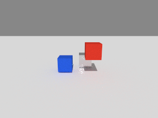
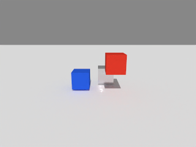

# sapien-cpu-probe

在没有 NVIDIA GPU 的 ARM Linux 机器上，检查 [SAPIEN](https://github.com/haosulab/SAPIEN) 能否用纯 CPU 跑通物理仿真和光线追踪渲染。

技术栈：

- **物理**：SAPIEN 3.0.2 CPU 构建（`PhysxCpuSystem`）
- **渲染**：Mesa Lavapipe 软件 Vulkan 光追
- **降噪（可选）**：CPU 版 Open Image Denoise（OIDN）

工具会搭一个带下落方块的小场景，渲染几帧，检查结果是否正确，最后输出一份 JSON 报告和渲染图片。在 RoboTwin、RMBench 等基于 SAPIEN 的 benchmark 接入 CPU 环境之前，可以先用它确认底层链路可用。

| 原始光追（32 spp） | OIDN 降噪后 |
|---|---|
|  |  |

目前只在**鲲鹏 920（aarch64，openEuler 24.03）**上验证过，详见 [hardware.md](docs/hardware.md)。

在同一套环境上，已经用 LingBot-VA（昇腾 NPU 推理）跑通了 RoboTwin 2.0 的闭环评测。所需补丁见 [docs/robotwin-rmbench.md](docs/robotwin-rmbench.md)，耗时分析见 [docs/performance.md](docs/performance.md)。


## 依赖

本工具不安装原生依赖，需要事先准备好：

| 依赖 | 已验证版本 | 说明 |
|---|---|---|
| 仿真用 Python 环境 | Python 3.12，NumPy 1.26，Pillow | 需能 `import sapien` |
| SAPIEN | 3.0.2，自行编译的 CPU 版 | 普通 `pip install sapien` 不行，编译方法见 [docs/setup.md](docs/setup.md) |
| Mesa Lavapipe | 26.2.6 | 需支持光追，24.x 不支持 |
| OIDN（可选） | 2.3.3 | 用于降噪，编译脚本见 `scripts/build_oidn.sh` |

运行本工具的 Python 只需要标准库（3.10+），可以和仿真用的 Python 不是同一个环境。

## 安装

可以安装成命令：

```bash
pip install --no-deps .
sapien-cpu-probe --help
```

## 使用

**1. 生成配置。** 告诉工具各个依赖装在哪里。结果写入一个新目录，不会修改系统或现有环境。

```bash
sapien-cpu-probe configure \
  --python /path/to/sim-venv/bin/python \
  --mesa-prefix /path/to/mesa-env \
  --library-dir /path/to/sapien-native/lib64 \
  --oidn-prefix /path/to/oidn-cpu \
  --output .local/my-machine
```

**2. 检查环境。** 确认能找到支持光追的软件 Vulkan 设备。

```bash
sapien-cpu-probe check \
  --profile .local/my-machine/profile.json \
  --output runs/check-001
```

**3. 渲染测试。** 实际跑物理和光追，并保存图片。

```bash
sapien-cpu-probe render \
  --profile .local/my-machine/profile.json \
  --output runs/render-001 --denoise
```

不装 OIDN 时，去掉 `--oidn-prefix` 和 `--denoise` 即可。不安装的话，在仓库根目录用 `python -m sapien_cpu_probe` 代替 `sapien-cpu-probe`，参数不变。

`render` 的常用参数：

| 参数 | 默认值 | 说明 |
|---|---|---|
| `--width` / `--height` | 320 / 240 | 分辨率 |
| `--spp` | 8 | 每像素采样数 |
| `--depth` | 8 | 光路深度 |
| `--frames` | 3 | 帧数，每帧之间步进 15 次物理 |
| `--timeout` | 180 | 超时秒数。第一帧要编译 shader，在鲲鹏上大约 35 秒 |

## 检查内容

- 使用 CPU 渲染和 CPU 物理，不会悄悄退回 GPU 或光栅化。
- 渲染出的图像尺寸正确、没有 NaN、不是空白图。
- 动态方块确实在重力下下落了。
- 子进程正常退出。退出时崩溃同样算失败，因为这类问题在 ARM 上踩到过。
- 启用 `--denoise` 时，还会实际执行一次 OIDN 降噪。

自动检查只能发现明显的错误。颜色、材质、阴影是否正确，仍需打开输出的图片看一眼。

## 输出

每次运行使用一个新的输出目录，已存在的目录会直接报错，不会被覆盖。

```
runs/render-001/
├── result.json        # 完整结果
├── worker.log         # 子进程日志，包含原生库的原始输出
├── frame-000.png ...  # 每帧渲染图
├── buffers.npz        # 最后一帧的 Color / HDR / Albedo / Normal
└── denoised.png       # 启用 --denoise 时生成
```

stdout 最后一行是与 `result.json` 内容相同的 JSON。退出码：`0` 通过，`1` 检查失败，`2` 参数或配置错误。

## 文档

- [docs/setup.md](docs/setup.md)：在新机器上准备 SAPIEN、Mesa、OIDN
- [docs/troubleshooting.md](docs/troubleshooting.md)：常见问题，例如 BLAS 构建崩溃、OIDN 报 SIGILL、加载了错误的 LLVM
- [docs/hardware.md](docs/hardware.md)：已验证的硬件和版本
- [docs/performance.md](docs/performance.md)：RoboTwin 闭环评测的耗时分析，以及如何提高吞吐
- [docs/robotwin-rmbench.md](docs/robotwin-rmbench.md)：接入 RoboTwin / RMBench，含 RoboTwin 2.0 的 CPU 补丁
- [AGENTS.md](AGENTS.md)：给 code agent 的操作说明

## 许可

`patches/sapien-3.0.2-cpu-build.patch` 修改的是 SAPIEN 源码，SAPIEN 的 Apache-2.0 许可声明见 `patches/SAPIEN-LICENSE`。`patches/robotwin-2eeec322-cpu.patch` 修改的是 [RoboTwin](https://github.com/RoboTwin-Platform/RoboTwin) 源码，RoboTwin 采用 MIT 许可。本仓库不包含 SAPIEN、Mesa、OIDN 等第三方二进制文件，也不包含 RoboTwin / RMBench 的资产。`docs/images/` 中的图片是本工具测试场景和 RoboTwin、LIBERO 闭环评测的渲染结果。

## 开发

```bash
python -m unittest discover -s tests -v
```

单元测试不依赖 SAPIEN。改动后仍需在真实环境中跑一遍 `render`。
