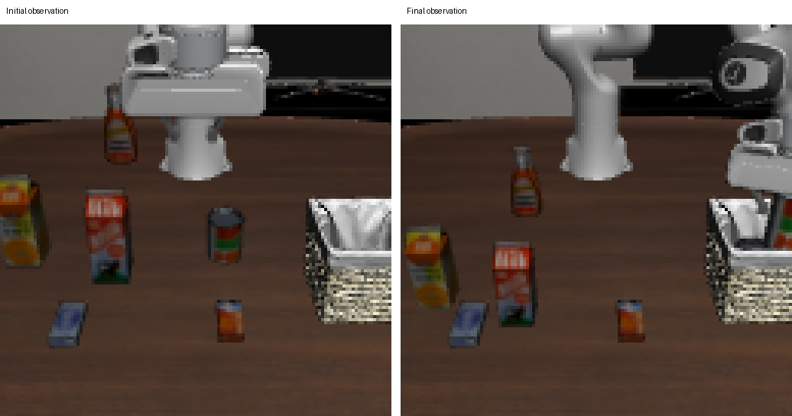
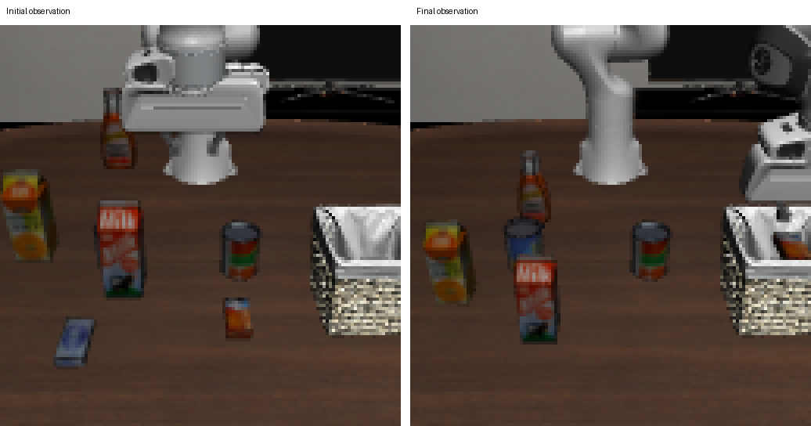

# LIBERO：CPU 仿真 + LingBot-VA NPU 推理

本仓库提供独立的 [examples/libero](../examples/libero) 复跑入口。LIBERO 使用 MuJoCo + Mesa llvmpipe 软件光栅化，不使用 SAPIEN，也不是光追。模型推理在昇腾 NPU 上运行，不能把整个闭环称为纯 CPU 推理。

## 已验证组合

- 鲲鹏 920，192 核，openEuler 24.03 LTS-SP3；客户端绑定 16 核，单张 Ascend 910B3 推理。
- LIBERO commit `8f1084e3132a39270c3a13ebe37270a43ece2a01`，任务集 `libero_10`（LIBERO-Long）。
- Python 3.10.22、MuJoCo 2.3.7、robosuite 1.4.0、bddl 1.0.1、gym 0.25.2、NumPy 1.26.4、CPU torch 2.5.1。
- OSMesa：Mesa 24.3.4，实测 GL renderer 为 `llvmpipe (LLVM 19.1.7, 128 bits)`；EGL：Mesa 26.2.6 + libglvnd 1.7.0。两种路径都已出图并完成闭环。
- 推理环境：torch 2.6.0、torch_npu 2.6.0.post5、diffusers 0.36.0、transformers 4.55.2。
- 权重：`robbyant/lingbot-va-posttrain-libero-long`，revision `0e89d1e753019988aba484e8da2dc0810e264d9f`。
- 推理代码使用已有的 **lingbot-va-fair NPU 工作树**，HEAD `6334d94f8b786a8b95a2343f4b6b237c64a32a36`，含已有未提交修改。不能据此声称原版 upstream checkout 在 NPU 上可直接运行；本例不提供完整 NPU 移植。

## 准备仿真环境

使用独立目录，不改系统 GL、共享 Python 或 shell 配置。以下命令中的路径需替换成本机路径。已具备环境时直接跳到运行部分。

```bash
export SIM_ENV=/path/to/new/libero-sim
export MESA_PREFIX=/path/to/new/osmesa
export LIBERO_ROOT=/path/to/LIBERO
export LIBERO_CONFIG_PATH=/path/to/new/libero-config

micromamba create -y -p "$SIM_ENV" -c conda-forge --override-channels python=3.10 mesalib=26.2.6 libgl libopengl pip
micromamba create -y -p "$MESA_PREFIX" -c conda-forge --override-channels mesalib=24.3.4
"$SIM_ENV/bin/python" -m pip install mujoco==2.3.7 robosuite==1.4.0 bddl==1.0.1 gym==0.25.2 numpy==1.26.4 \
  easydict einops hydra-core==1.2.0 'opencv-python-headless<4.11' imageio imageio-ffmpeg tqdm \
  websockets msgpack typing_extensions future matplotlib cloudpickle torch==2.5.1 pillow termcolor PyOpenGL==3.1.10

git clone https://github.com/Lifelong-Robot-Learning/LIBERO.git "$LIBERO_ROOT"
git -C "$LIBERO_ROOT" checkout 8f1084e3132a39270c3a13ebe37270a43ece2a01
```

LIBERO 的 editable install 在已测环境中没有暴露顶层 namespace；用 `.pth` 指向源码，并创建独立配置，避免首次 import 写入 `~/.libero` 或询问路径：

```bash
"$SIM_ENV/bin/python" - <<'PY'
import os, site
from pathlib import Path
import yaml
root = Path(os.environ['LIBERO_ROOT']).absolute()
Path(site.getsitepackages()[0], 'libero_src.pth').write_text(str(root) + '\n')
base = root / 'libero/libero'
config = Path(os.environ['LIBERO_CONFIG_PATH'])
config.mkdir(parents=True, exist_ok=False)
paths = {'benchmark_root': base, 'bddl_files': base/'bddl_files',
         'init_states': base/'init_files', 'assets': base/'assets',
         'datasets': root/'datasets'}
(config/'config.yaml').write_text(yaml.safe_dump({k: str(v) for k, v in paths.items()}))
PY
```

## 运行：两个终端、两个环境

先确认设备空闲。只使用自己启动的 policy server，不连接其他任务的服务。下面以 NPU 1 和两个独立端口为例；端口和设备号需根据本机占用选择。`LINGBOT_REPO` 指向已经验证能在 NPU 运行的 LingBot-VA 工作树，`PROBE_REPO` 指向本仓库。

服务端终端（独立子 shell 中执行）：

```bash
source /usr/local/Ascend/ascend-toolkit/set_env.sh
export LINGBOT_REPO=/path/to/lingbot-va-fair
export PROBE_REPO=/path/to/sapien-cpu-probe
export NPU_PYTHON=/path/to/npu-env/bin/python
export LIBERO_WEIGHTS=/path/to/lingbot-va-posttrain-libero-long
export RUN_DIR=/path/to/new/run
mkdir "$RUN_DIR"
cd "$RUN_DIR"
export ASCEND_RT_VISIBLE_DEVICES=1 LINGBOT_DEVICE=npu OMP_NUM_THREADS=8
export NO_PROXY=localhost,127.0.0.1,::1 no_proxy=localhost,127.0.0.1,::1
"$NPU_PYTHON" -m torch.distributed.run --nproc_per_node 1 \
  --master_addr 127.0.0.1 --master_port 29311 \
  "$PROBE_REPO/examples/libero/server.py" --ckpt "$LIBERO_WEIGHTS" \
  --host 127.0.0.1 --port 29310 --save_root "$RUN_DIR/server_vis" > "$RUN_DIR/server.log" 2>&1
```

等日志出现 `server listening`，再在客户端终端设置路径并运行：

```bash
export PROBE_REPO=/path/to/sapien-cpu-probe
export LINGBOT_REPO=/path/to/lingbot-va-fair
export SIM_ENV=/path/to/libero-sim
export MESA_PREFIX=/path/to/osmesa
export LIBERO_CONFIG_PATH=/path/to/libero-config
export RUN_DIR=/path/to/the/same/run
export MUJOCO_GL=osmesa SIM_THREADS=16
source "$PROBE_REPO/examples/libero/sim_env.sh"
taskset -c 96-111 "$SIM_ENV/bin/python" -I "$PROBE_REPO/examples/libero/client.py" \
  --benchmark libero_10 --tasks 0 1 --episodes 1 --res 128 --max-steps 800 \
  --host 127.0.0.1 --port 29310 --out-dir "$RUN_DIR/results" > "$RUN_DIR/client.log" 2>&1
status=$?
printf '%s\n' "$status" > "$RUN_DIR/client.exit"
```

`96-111` 是实测机器的 CPU affinity，换机时选择可用 CPU。每次使用新输出目录。结束后在服务端终端 Ctrl-C，释放自己的 NPU 服务。

如需 EGL，在新的客户端 shell 中将 `MUJOCO_GL=egl`、`MESA_PREFIX=$SIM_ENV`，其余相同。不能只换环境变量却沿用前一进程已加载的 GL 库。

## 验收与输出

检查 `client.exit` 为 0、日志包含 `CLIENT_DONE`，并读取 `results/client_run.json` 中每个 episode 的 `success`。成功由原环境 `done` 判定；客户端正常退出不等于任务成功。`episodes_partial.json` 只是运行中的阶段记录。

每个任务输出双相机 MP4 和初末帧 `.npy`。用 `"$SIM_ENV/bin/python" "$PROBE_REPO/examples/libero/frames.py" /path/to/0_first_last_agentview.npy /path/to/new.png` 导出初末帧对照图（最近邻放大，不补细节）。视频 15 fps 只是播放速度，不是实时控制频率。计时字段包括动作推理、KV 更新、env.step 和渲染；`env_step_physics_and_obs_excl_render` 包含观测处理，不能叫纯物理耗时。episode 总耗时不含服务端模型加载，也不含末尾视频编码。

控制协议沿用原客户端：reset、指定初始状态、5 个零动作；首次 action chunk 跳过第一个 frame，执行后更新 KV。实测 action shape 为 `[7, 4, 4]`，每次推理产生 16 个环境动作，首个 chunk 执行 12 个。客户端按 `action.shape[2] // 4` 取观测，因此本配置每个动作都收集观测（不是每 4 个动作抽一帧）；服务端再按自己的协议处理历史。

## 踩过的坑

- PyOpenGL 报 `NoneType ... glGetError`：除了 Mesa，还需要 `libGL.so.1`（conda-forge `libgl` / `libopengl`）。
- Mesa 26 的已测包不含 `libOSMesa.so.8`：用独立 Mesa 24.3.4 prefix，不替换系统库。
- robosuite 缺 `termcolor`：在独立仿真环境安装。
- EGL 清理阶段可能出现 `Exception ignored in __del__` 的 `EGLError`。保留原始日志并检查退出码；不能把原生崩溃当成功。
- 单卡 NPU 的 FSDP 报 fp32/bf16 混合参数：`server.py` 仅在本进程替换 `_configure_model`，使用 eval、显式转换 compute dtype、迁移 device。仅支持单卡；不改共享代码，不改归一化和去噪参数。

## 实测记录

首次两个 episode 的结果见 [performance.md](performance.md)。本次使用仓库内的 `server.py` / `client.py` 重新运行，同样采用初始状态索引 0，两个任务均用 OSMesa。没有设置额外的全局随机种子，因此动作步数不要求与首次一致。

| 任务 | 结果 | 动作数（不含 5 个初始化动作） | episode 耗时 | 推理中位数 | 双相机渲染中位数 / env.step |
|---|---|---|---|---|---|
| task 0 | 成功 | 283 | 409.0 s | 12.76 s | 435 ms |
| task 1 | 成功 | 269 | 392.1 s | 12.38 s | 432 ms |

测试日期：2026-11-10。task 0：汤罐和番茄酱放进篮子；task 1：奶油奶酪盒和黄油放进篮子。客户端输出 `CLIENT_DONE`，退出码 **0**。每个任务只运行 1 个 episode，不代表成功率。

完整分项计时、GL renderer 和代码/权重信息见 [JSON 记录](results/libero-repro-20261110.json)。其中视频和 NPY 路径已转为相对路径；大文件保留在本地实验目录，未纳入仓库。




