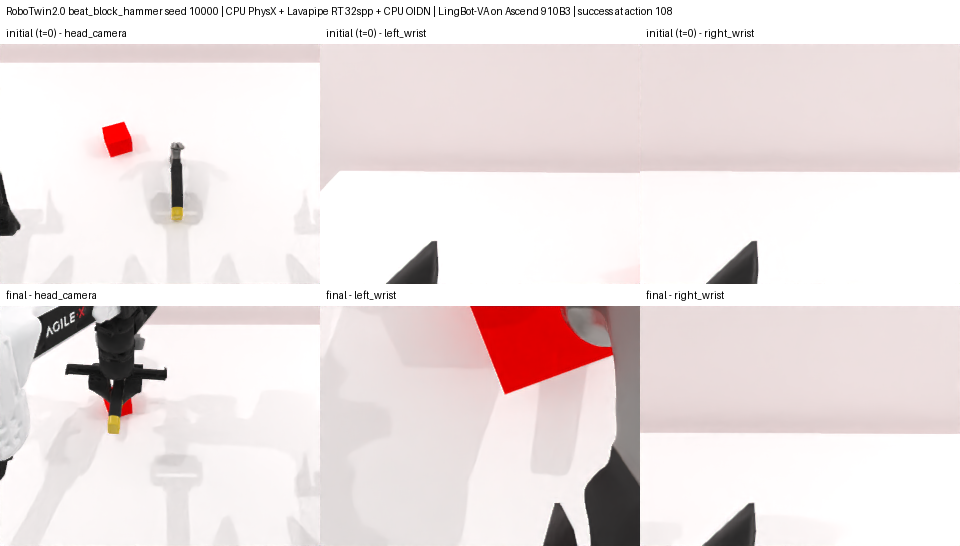
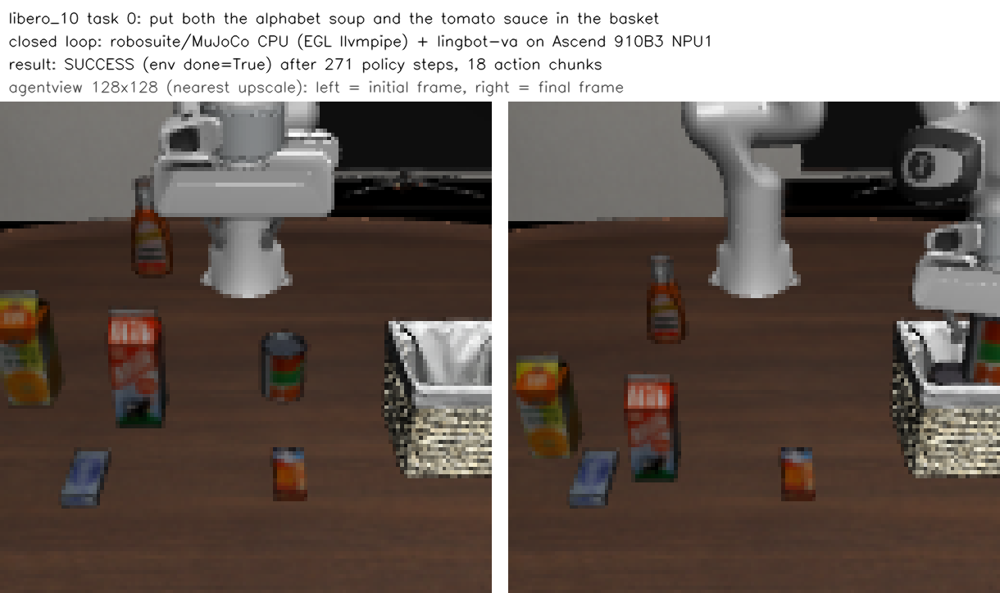

# 性能

本页的数据都是在鲲鹏 920 上用 `time.monotonic` 实际测得的，机器配置见 [hardware.md](hardware.md)。这台机器同时有其他任务在运行，各项数字只能作为量级参考。

## 测试场景

`arm64-cpu-robot-sim render` 的方块场景，单进程 4 线程：

| 参数 | 第一帧 | 之后每帧 | OIDN 降噪 |
|---|---|---|---|
| 320×240，8 spp，光路深度 8 | 34 秒 | 0.7 秒 | — |
| 320×240，32 spp，光路深度 8 | 36 秒 | 2.5 秒 | 0.4 秒 |

第一帧要编译 shader 和 JIT，所以明显更慢。

## RoboTwin 2.0 闭环评测

- **仿真**：RoboTwin 2.0（commit `2eeec322`，打上 [patches/robotwin-2eeec322-cpu.patch](../patches/robotwin-2eeec322-cpu.patch)），全部在 CPU 上运行。
- **渲染**：光追，32 spp，光路深度 8，开阴影，CPU OIDN 降噪。head、左腕、右腕三个相机，分辨率均为 320×240。
- **CPU 资源**：Lavapipe 24 线程，绑定 24 个核。
- **策略**：LingBot-VA（`lingbot-va-posttrain-robotwin`），在 1 张昇腾 910B3 NPU 上推理，每次输出 32 个动作。
- **任务设置**：`demo_clean`，seed 10000，每个任务跑 1 个 episode。

| 项目 | click_bell | beat_block_hammer |
|---|---|---|
| 结果 | 成功（第 61 个动作） | 成功（第 108 个动作） |
| 单个 episode 总耗时 | 595 秒 | 785 秒 |
| 冷启动：从启动进程到拿到第一帧观测 | 149 秒 | 146 秒 |
| └ 其中第一次渲染（光追预热） | 127 秒 | 123 秒 |
| 稳定后取一次观测（3 个相机） | 18.0 秒 | 18.8 秒 |
| └ 其中每张图的 OIDN 降噪 | 0.31 秒 | 0.31 秒 |
| 物理仿真，每步 | 0.55 ms | 0.67 ms |
| 物理仿真，整个 episode 合计 | 3.8 秒 | 8.0 秒 |
| NPU 推理，每次 | 12.1 秒 | 12.1 秒 |
| NPU 推理，整个 episode 合计 | 36 秒 | 49 秒 |

单个 episode 里，**取观测（主要是光追渲染）占约 90% 的时间**；物理仿真和 MPlib 规划只占几秒，NPU 推理约占 6%。

每个任务只跑了 1 个 episode，表中的"成功"不能当作成功率。

## 加快渲染的办法

在 RMBench 的 Press Button 任务上，用同样的光追设置（320×240，32 spp，原始 mesh，带阴影和 OIDN）对比了不同的进程数和线程数组合，每组渲染 3 帧稳定帧：

| 配置 | 吞吐 | 单帧耗时 | 冷启动 |
|---|---|---|---|
| 1 进程 × 16 线程 | 0.12 张/秒 | 8.1 秒 | 74 秒 |
| 8 进程 × 24 线程 | 1.25 张/秒 | 5.7 秒 | 72 秒 |

8 进程 × 24 线程的吞吐是单进程的 10.8 倍，但会占用约 116 个核。Lavapipe 的单进程扩展性不好，要提高吞吐，**同时跑多个仿真进程**比给单个进程加线程有效得多。

如果对画质要求不高，也可以降低 spp：在 RoboTwin 的 head 相机上，32 spp 每帧约 5.8 秒，8 spp 约 1.5 秒。

## 对比：LIBERO（MuJoCo）

LIBERO 不使用 SAPIEN。独立复跑入口和环境说明见 [libero.md](libero.md)。下面保留首次测试数据，复跑记录另列在该文档中。测试条件：

- **任务**：LIBERO-Long（libero_10）task 0 用 EGL 渲染，task 1 用 OSMesa 渲染，各跑 1 个 episode。
- **仿真**：robosuite 1.4 + MuJoCo 2.3.7，在 CPU 上运行。
- **渲染**：Mesa llvmpipe 软件光栅化，2 个相机，分辨率 128×128。
- **CPU 资源**：16 个核。
- **策略**：LingBot-VA（`lingbot-va-posttrain-libero-long`），在 1 张 NPU 上推理，每次输出 16 个动作。

| 项目 | EGL（Mesa 26） | OSMesa（Mesa 24） |
|---|---|---|
| 任务 | task 0 | task 1 |
| 结果 | 成功（271 步） | 成功（255 步） |
| 单个 episode 总耗时 | 496 秒 | 361 秒 |
| 冷启动 | 40 秒 | 18 秒 |
| 物理 + 观测处理（扣除渲染），每步 | 41 ms | 42 ms |
| 渲染 2 个相机，每步 | 762 ms | 428 ms |
| NPU 推理，每次 | 12.0 秒 | 11.8 秒 |

LIBERO 的单个 episode 里，用 EGL 时仿真和 NPU 推理大约各占一半，换成 OSMesa 后 NPU 推理约占 60%。渲染同样是 CPU 端的瓶颈，但给 llvmpipe 增加线程没有效果：同样 16 个核，16 线程和 4 线程的渲染耗时几乎一样。OSMesa 比 EGL 快约 1.8 倍。
