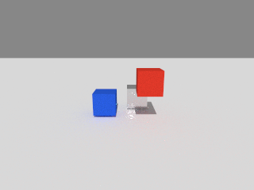
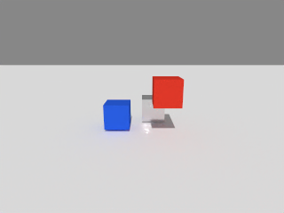

# SAPIEN 检查工具

验证 CPU 物理、Lavapipe 光追和可选的 CPU OIDN 降噪。此工具用于 RoboTwin / RMBench 的底层链路检查；LIBERO 请使用[独立示例](libero.md)。

| 原始光追（32 spp） | OIDN 降噪后 |
|---|---|
|  |  |

## 依赖

本工具不安装原生依赖，需要事先准备好：

| 依赖 | 已验证版本 | 说明 |
|---|---|---|
| 仿真用 Python 环境 | Python 3.12，NumPy 1.26，Pillow | 需能 `import sapien` |
| SAPIEN | 3.0.2，自行编译的 CPU 版 | 普通 `pip install sapien` 不行，编译方法见 [docs/setup.md](setup.md) |
| Mesa Lavapipe | 26.2.6 | 需支持光追，24.x 不支持 |
| OIDN（可选） | 2.3.3 | 用于降噪，编译脚本见 `scripts/build_oidn.sh` |

运行本工具的 Python 只需要标准库（3.10+），可以和仿真用的 Python 不是同一个环境。

## 安装 SAPIEN 检查工具

可以安装成命令：

```bash
pip install --no-deps .
arm64-cpu-robot-sim --help
```

## 验证 SAPIEN 底层链路

**1. 生成配置。** 告诉工具各个依赖装在哪里。结果写入一个新目录，不会修改系统或现有环境。

```bash
arm64-cpu-robot-sim configure \
  --python /path/to/sim-venv/bin/python \
  --mesa-prefix /path/to/mesa-env \
  --library-dir /path/to/sapien-native/lib64 \
  --oidn-prefix /path/to/oidn-cpu \
  --output .local/my-machine
```

**2. 检查环境。** 确认能找到支持光追的软件 Vulkan 设备。

```bash
arm64-cpu-robot-sim check \
  --profile .local/my-machine/profile.json \
  --output runs/check-001
```

**3. 渲染测试。** 实际跑物理和光追，并保存图片。

```bash
arm64-cpu-robot-sim render \
  --profile .local/my-machine/profile.json \
  --output runs/render-001 --denoise
```

不装 OIDN 时，去掉 `--oidn-prefix` 和 `--denoise` 即可。不安装的话，在仓库根目录用 `python -m arm64_cpu_robot_sim` 代替 `arm64-cpu-robot-sim`，参数不变。

`render` 的常用参数：

| 参数 | 默认值 | 说明 |
|---|---|---|
| `--width` / `--height` | 320 / 240 | 分辨率 |
| `--spp` | 8 | 每像素采样数 |
| `--depth` | 8 | 光路深度 |
| `--frames` | 3 | 帧数，每帧之间步进 15 次物理 |
| `--timeout` | 180 | 超时秒数。第一帧要编译 shader，在鲲鹏上大约 35 秒 |

## 检查内容

- 使用 CPU 渲染和 CPU 物理，不会悄悄退回 GPU 或光栅化。
- 渲染出的图像尺寸正确、没有 NaN、不是空白图。
- 动态方块确实在重力下下落了。
- 子进程正常退出。退出时崩溃同样算失败，因为这类问题在 ARM 上踩到过。
- 启用 `--denoise` 时，还会实际执行一次 OIDN 降噪。

自动检查只能发现明显的错误。颜色、材质、阴影是否正确，仍需打开输出的图片看一眼。

## 输出

每次运行使用一个新的输出目录，已存在的目录会直接报错，不会被覆盖。

```
runs/render-001/
├── result.json        # 完整结果
├── worker.log         # 子进程日志，包含原生库的原始输出
├── frame-000.png ...  # 每帧渲染图
├── buffers.npz        # 最后一帧的 Color / HDR / Albedo / Normal
└── denoised.png       # 启用 --denoise 时生成
```

stdout 最后一行是与 `result.json` 内容相同的 JSON。退出码：`0` 通过，`1` 检查失败，`2` 参数或配置错误。
